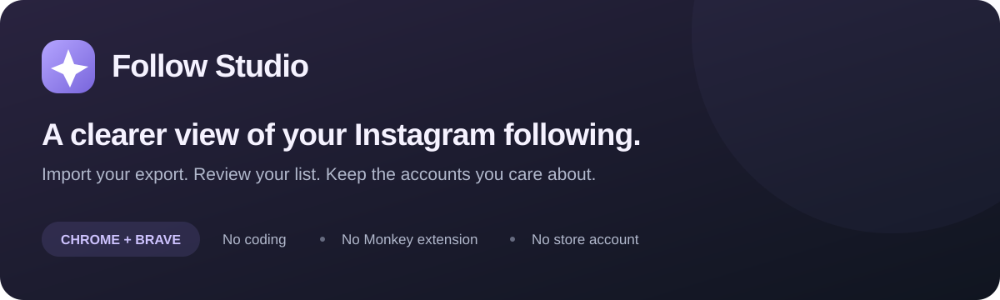
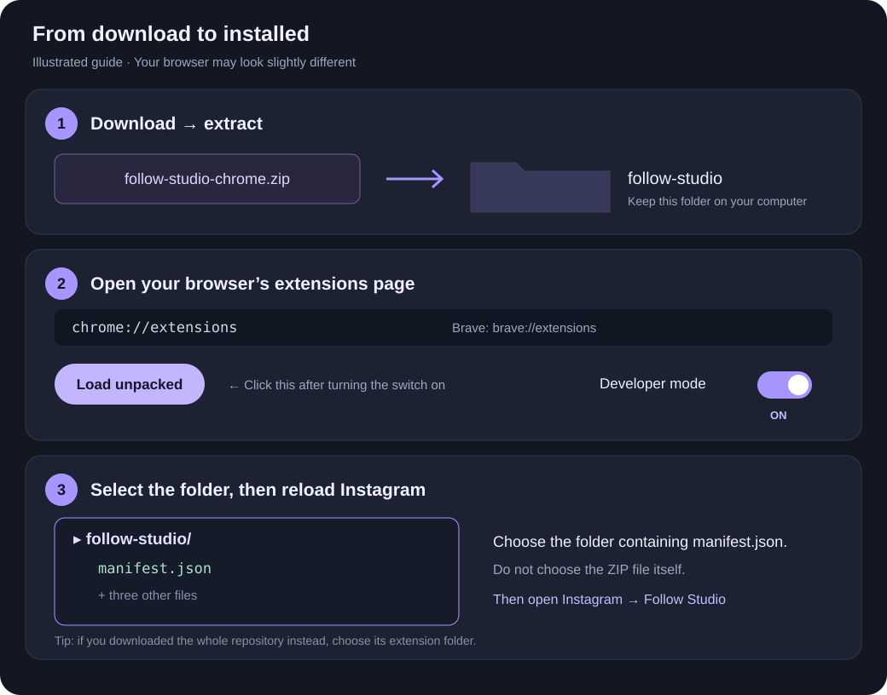
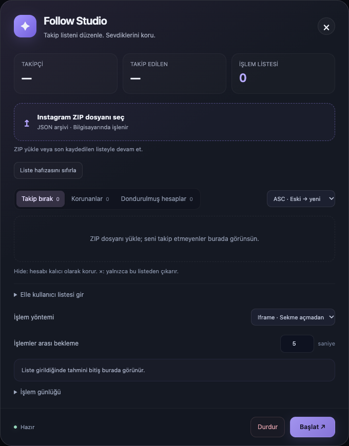

<p align="center">
  
</p>

<p align="center">
  <strong>Download it. Add it to your browser. Open Instagram.</strong><br>
  No terminal, coding, paid account, or Chrome Web Store installation needed.
</p>

<p align="center">
  <a href="https://github.com/kakcil/instagram-follow-studio/releases/latest/download/follow-studio-chrome.zip"><strong>⬇ Download Follow Studio for Chrome / Brave</strong></a>
  &nbsp; · &nbsp;
  <a href="#install-follow-studio">Installation guide</a>
  &nbsp; · &nbsp;
  <a href="#need-help">Need help?</a>
</p>

Follow Studio compares the accounts you follow with the followers listed in your Instagram data download. You can review the results, protect accounts you want to keep, and start an unfollow queue when you are ready.

**For desktop Chrome and Brave.** The app's buttons are currently in Turkish; this guide explains them in English. You do not need Violentmonkey for the browser extension.

> [!IMPORTANT]
> Results describe **the data in your Instagram ZIP**, not a live check of who follows you now. An incomplete or outdated export can produce incorrect candidates. Download **all-time** data and review the list before starting.

## Install Follow Studio



### 1. Download and unzip

Click **[Download Follow Studio](https://github.com/kakcil/instagram-follow-studio/releases/latest/download/follow-studio-chrome.zip)** above. The file is named **follow-studio-chrome.zip**.

- **Windows:** right-click the ZIP → **Extract All** → **Extract**.
- **Mac:** double-click the ZIP.

You should now have a folder named **follow-studio**. Move it somewhere you will keep it, such as Documents. Your browser loads the extension from this folder, so keep it there after installation.

### 2. Open the extensions page

Copy the address for your browser into the address bar at the **top of your browser window**, then press Enter. Do not type it into a Google search box.

| Your browser | Copy this address |
| --- | --- |
| Chrome | `chrome://extensions` |
| Brave | `brave://extensions` |

### 3. Turn on Developer mode

Switch **Developer mode** on near the top-right corner. This reveals the button used to install a downloaded extension. You do not need to write or edit any code.

### 4. Click Load unpacked and choose the folder

Click **Load unpacked**, then select the extracted **follow-studio** folder.

**Choose the folder containing `manifest.json`. Do not select the ZIP file or open individual code files.** This is the folder's contents:

```text
📁 follow-studio           ← select this folder
   ├── manifest.json
   ├── background.js
   ├── bridge.js
   └── content.js
```

A **Follow Studio** card should appear on the extensions page. Make sure its on/off switch is on. These are the same local installation steps described in [Google's extension guide](https://developer.chrome.com/docs/extensions/get-started/tutorial/hello-world#load-unpacked).

### 5. Open Instagram

Open **[www.instagram.com](https://www.instagram.com/)** and sign in normally. If Instagram was already open, **reload the page**.

Click **✦ Follow Studio** in the bottom-right corner. The panel stays closed until you open it. You can also open it from the browser's extensions menu while Instagram is open.

> [!TIP]
> Already using the old Violentmonkey version? Turn that script **off** first. Its saved lists and protected accounts do not move into the standalone extension automatically. Import your ZIP again and protect the accounts you want to keep before starting.

## Get your Instagram data

Installing the extension and importing your Instagram data are separate steps.

| Download | What it is | What to do with it |
| --- | --- | --- |
| **Follow Studio ZIP** | The public extension downloaded from this page | **Unzip it** and install its folder in your browser |
| **Instagram data ZIP** | Your personal followers and following export from Instagram | **Keep it zipped** and choose it inside Follow Studio |

To request the second file:

1. Open **Instagram settings**, then **Accounts Center**.
2. Find the option to **download or export your information** and select your Instagram account. Meta manages these downloads through Accounts Center; menu wording can vary. [Meta's explanation](https://about.fb.com/news/2023/10/manage-your-information-across-apps/)
3. Select the information for **Followers and following**. Include both lists.
4. Set the **date range to All time** and the **format to JSON**.
5. Request the download. When Instagram makes it available, save its ZIP to your computer.

| Setting | Choose |
| --- | --- |
| Information | **Followers and following** |
| Date range | **All time** |
| File format | **JSON** |

Keep the Instagram ZIP private. You do not need to send it to us or upload it to GitHub.

## Open your list and review it

<p align="center">
  
</p>

<p align="center"><em>The actual panel, shown with no imported data or account names.</em></p>

1. Click **Instagram ZIP dosyanı seç** — this means **Choose your Instagram ZIP**.
2. Select the **personal ZIP downloaded from Instagram**, not the extension ZIP.
3. Wait for the list to appear. These are accounts listed under **following** but missing from **followers** in that export.
4. Use **Hide** on any account you want to keep following. It moves into the protected section.
5. Check the remaining list before clicking Start.

### What the buttons mean

| Label in the app | Meaning | What it does |
| --- | --- | --- |
| **Takip bırak** | Unfollow list | Accounts eligible for the main queue |
| **Korunanlar** | Protected | Accounts you marked with Hide; excluded from unfollowing |
| **Dondurulmuş hesaplar** | Unavailable accounts | Profiles the extension could not process; can be retried separately |
| **Hide** | Protect this account | Keeps the account out of the unfollow queue, including after later imports |
| **×** beside an account | Remove from this list | Removes the entry; does **not** unfollow the account |
| **ASC · Eski → yeni** | Oldest first | Sorts by the date you followed the account |
| **DESC · Yeni → eski** | Newest first | Reverses that order |
| **Başlat** | Start | Processes the selected section's eligible accounts |
| **Durdur** | Stop | Stops subsequent actions; cannot undo an action already sent |

**Unavailable does not always mean deactivated.** A slow page, changed button, or loading problem can also place an account in that section. Select that tab and click Start to retry only its eligible accounts.

## Start when you are ready

- **İşlemler arası bekleme** means **wait between accounts**. The default is **5 seconds**. Page loading and processing take additional time; the estimate updates after the first result.
- **İşlem yöntemi** means **processing method**. The default iframe option tries a hidden page first. If it cannot connect, the extension switches to background tabs. Those tabs close after processing.
- Click **Başlat** to start. The counters change to **unfollowed**, **failed/skipped**, and **remaining**.
- Successful entries disappear from the main list. Unavailable profiles move into their own section. Other failures do not stop the rest of the queue.
- Keep the original Instagram tab open. Closing or reloading it stops the run. Only one tab can run a queue at a time.

Your list is saved on this computer. You can reopen the panel later without choosing the same ZIP again. **Importing a new ZIP replaces the main list and the last run's results; protected and unavailable accounts are kept.**

## Need help?

| What you see | What to try |
| --- | --- |
| **“Manifest file is missing”** during installation | The wrong folder was selected. Open the extracted folders until you see `manifest.json`, then select the folder containing it. If you downloaded the entire GitHub repository instead, select its **extension** folder. |
| **No Load unpacked button** | Turn on **Developer mode** on the browser's extensions page. |
| **No Follow Studio button on Instagram** | Check that the extension is enabled, open **www.instagram.com**, and reload the page. |
| **The ZIP will not load / JSON files not found** | Choose your **Instagram data ZIP**, not the extension ZIP. Request the export in **JSON**, with both followers and following included. |
| **Someone who follows me appears in the list** | The archive may be outdated or incomplete. Stop, review the account on Instagram, and request a fresh **All time** export. The extension cannot confirm live follower status. |
| **The main list is empty** | There may be no unmatched accounts in that ZIP, or the candidates may already be protected, removed, processed, or in the unavailable section. |
| **My old protected accounts are missing after switching from Monkey** | The two versions have separate storage. Protect those accounts again before starting in the extension. |
| **I want to clear the current list** | Click **Liste hafızasını sıfırla**. It clears the main list and run summary, while keeping protected and unavailable accounts. |

Still stuck? [Open an issue](https://github.com/kakcil/instagram-follow-studio/issues). Describe what happened and include the extension version. Do not attach your personal export, login information, or screenshots containing real account names.

## Updating

There are no automatic store updates for this version.

1. Stop any running queue.
2. Download and extract the latest extension ZIP.
3. Replace the files **inside the same folder you originally installed** with the new files. Keep the folder in the same location.
4. Open `chrome://extensions` or `brave://extensions` and click the **Reload** icon on the Follow Studio card.
5. Reload Instagram.

Avoid removing and reinstalling the extension when updating: removal can delete its saved data.

## Your data stays on your computer

| Data | Where it goes |
| --- | --- |
| Your Instagram ZIP | Read locally in your browser; not sent to a Follow Studio server |
| Parsed lists, ZIP filename, protected/unavailable accounts, and run summary | Saved in the extension's local storage; not Chrome Sync |
| Unfollow actions | Sent to Instagram through your existing signed-in session |
| Optional photo links | Open the linked image address only when you click them |

Follow Studio has no analytics server, AI service, or API key requirement. It requests access to **www.instagram.com** and **local storage**. The repository and guide contain no personal exports or real Instagram account lists. To remove all saved extension data, uninstall the extension.

Follow Studio is independent of Instagram and Meta. It uses visible page controls, so changes to Instagram's interface can affect it.

<details>
<summary><strong>Optional: use the old Violentmonkey version</strong></summary>

If you prefer a userscript, install Violentmonkey and open the [userscript installation link](https://raw.githubusercontent.com/kakcil/instagram-follow-studio/main/instagram-follow-studio.user.js). Confirm the installation in Violentmonkey and reload Instagram. If the link displays source code, download the file and import it into Violentmonkey.

Run either the userscript or the standalone extension, not both. Their saved data is separate.

</details>

<details>
<summary><strong>For developers — not needed to install or use the extension</strong></summary>

Node.js 22.13 or newer:

```sh
npm ci
npm run build
npm test
npm run check
npm run package
```

The shared UI and export parser are in `instagram-follow-studio.user.js`. The build adapter generates `extension/content.js`; edit the source or adapter rather than that generated file. `extension/background.js` manages worker ownership and rechecks archive eligibility and protection before clicks.

Tests use synthetic data and mocked browser APIs. They do not connect to real Instagram accounts or perform live unfollows. The package command includes only the four extension files in `dist/follow-studio-chrome.zip`.

</details>

---

[MIT License](LICENSE) · [Download](https://github.com/kakcil/instagram-follow-studio/releases/latest/download/follow-studio-chrome.zip) · [Report a problem](https://github.com/kakcil/instagram-follow-studio/issues)
